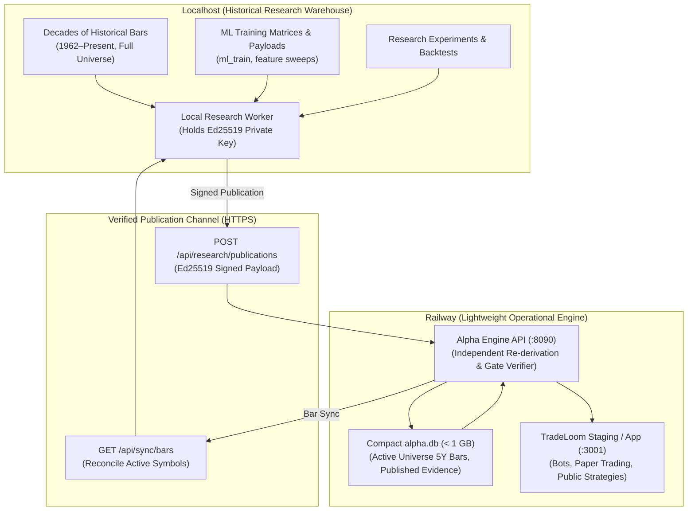
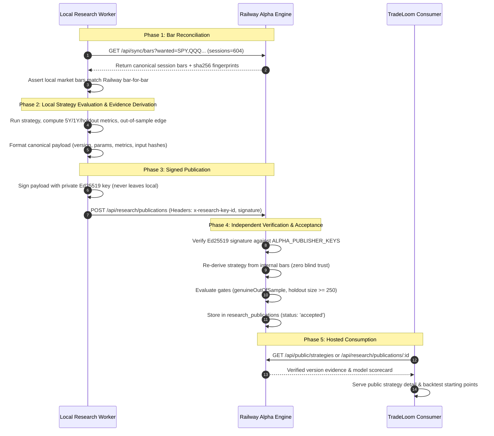

# Alpha Engine — Local Research → Verified Publication → Hosted Consumption Contract

**Status:** Canonical Architectural Contract  
**Applies to:** Alpha Engine (Python) & TradeLoom (Node/React)  
**Security & Verification Baseline:** Ed25519 Signed Publications (`research-publication/v1`), Deterministic Canonical Fingerprints (`bar-sync/v1`)  

---

## 1. Context & Architectural Principles

We explicitly reject cloud data lakes, distributed warehouse clusters, and hosted volume upgrades during POC development. Instead, we establish a clean, durable **division of responsibility**:

* **Localhost** is our **long-term historical data warehouse** and research laboratory. It holds multi-decade price histories, large machine learning datasets, experimental parameter sweeps, and raw research artifacts without storage or compute constraints.
* **Railway** is our **lightweight, production-facing operational engine**. It runs continuously, fast, and inexpensively on standard container volumes, holding only active market data, current published research, and active bot trading state.

---

## 2. Division of Responsibility

| Data Category | Localhost (Research Archive) | Railway (Hosted Operational Engine) |
|---|---|---|
| **Market Price Bars** | **Complete historical archive** (all symbols, intraday, decades back to 1962). | **Supported universe only** (10–150 symbols), 5-year daily history for active backtests and paper trading. |
| **Machine Learning Datasets** | **Full retention** (`ml_train`, `ml_learning_rows`, raw features). | **Excluded entirely** (0 MB on hosted volume). |
| **Feature Engineering History** | **Full retention** across historical experiments and universes. | **Only operationally active features** (current universe `feature_snapshot`). |
| **Research Experiments** | **Complete archive** of exploratory hypotheses, notebooks, and model runs. | **Current published research state** (`research_publications` table). |
| **Predictions & Rankings** | **Full historical telemetry** and prediction scoring records. | **Current and recent active records** needed for platform consumers. |
| **Platform Backtest Results** | **Optional historical copies** and variant exploration logs. | **Published version evidence** (persisted in TradeLoom `StrategyEvidence`). |
| **User Bots & Paper Executions** | Optional staging mirror / test fixtures. | **Authoritative live database** (TradeLoom MySQL / Prisma). |

---

## 3. The Three Operating Rules

### Rule 1: Localhost Retains the Long Tail
Historical datasets, feature matrices, ML training samples, and exploratory experiments can grow indefinitely on local developer disks without consuming Railway volume. Local storage is authoritative for model training and hypothesis testing.

### Rule 2: Railway Remains Independently Operational
The hosted platform must be fully self-sufficient. Daily paper trading, published strategy evidence, public strategy catalog viewing, and 5-year user backtests in TradeLoom must continue functioning with zero degradation **even when your local machine is completely offline or asleep**.

### Rule 3: Publication is Selective, Not Database Synchronization
We do **not** run SQLite database replication, cross-network file copies, or rsync scripts. Only validated datasets, strategy versions, and cryptographic evidence needed by the hosted application are published to Railway.

> [!IMPORTANT]
> **Durability Note:** While localhost is the primary historical warehouse, local disks fail. A secondary offsite backup (e.g. periodic archive copy of `alpha.db.backup_full` onto external media) is required for disaster recovery.

---

## 4. The Formal Publication Protocol

This contract reuses the existing `research-publication/v1` and `bar-sync/v1` implementations in [ae-research/app/research_publication/contract.py](file:///home/administrator/web/alpha-trading-platform/ae-research/app/research_publication/contract.py):

### Request Signing Specification
Requests to `POST /api/research/publications` must supply:
* `x-research-key-id`: The identifier of the publisher key.
* `x-research-timestamp`: Current Unix timestamp in seconds (rejects clock skew $> 300\text{s}$).
* `x-research-signature`: Base64-encoded Ed25519 signature over:
  $$\text{METHOD} \parallel \text{"\textbackslash n"} \parallel \text{PATH?QUERY} \parallel \text{"\textbackslash n"} \parallel \text{TIMESTAMP} \parallel \text{"\textbackslash n"} \parallel \text{SHA256}(\text{body})$$

Railway holds **only public keys** in `ALPHA_PUBLISHER_KEYS`. Compromising the hosted environment cannot result in forged research publications.

### Independent Railway Verification (Zero-Trust Principle)
Railway treats worker claims strictly as hypotheses:
1. **Provenance:** Railway verifies that the worker's input bar fingerprints equal Railway's internal bars.
2. **Freshness:** Input bars must terminate on Railway's latest session close.
3. **Deterministic Reproduction:** Railway executes the registered strategy definition internally; output decisions and metrics must match the worker's payload byte-for-byte.
4. **Out-of-Sample Quality Gate:** Holdout window must be strictly out-of-sample (ends post development cutoff) with at least 250 sessions.

---

## 5. Storage Governance Policy

1. **Volume Ceiling Target:** Railway `alpha.db` shall remain **$< 1.5\text{ GB}$**, ensuring at least **$3.5\text{ GB}$ free** on the 5 GB plan.
2. **No Bulk Raw Exports on Hosted Volume:** Experimental tenant rows (like `ml_train`) are barred from Railway.
3. **No In-Place Vacuum on Railway:** When compaction is needed in the future, it must be performed externally or into temporary scratch space, never in-place on a full volume.
4. **TradeLoom Retention:** TradeLoom stores user bots, order executions, and published evidence snapshots in MySQL, completely independent of Alpha Engine's operational footprint.

---

## 6. Implementation Checklist & Status

- [x] **Compact Database Deployed:** `alpha.db` reduced from 5.74 GB to **788 MB** (86.3% reduction).
- [x] **Local Full Archive Secured:** Full 5.74 GB database backed up at `alpha-engine/backups_pre_compact/alpha.db.backup_20261124_full`.
- [x] **`scanner.py` Fixed:** Obsolete `ml_train` dependency updated to authoritative `default` market data.
- [x] **Wire Contract Operational:** Signed publication contract (`app.research_publication.contract`) and verification routes (`/api/sync/bars`, `/api/research/publications`) active and verified on port 8090.
- [x] **TradeLoom Integration Healthy:** Public strategies, 5-year backtests, and daily paper simulation running smoothly without hosted storage pressure.
